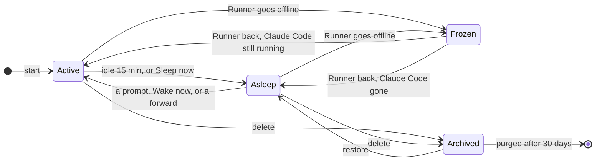

A Session is always in one of four states. The Hub decides which; the Runner does what it asks.

| State | Sandbox | Claude Code | Prompts |
|---|---|---|---|
| **Active** | running | running in tmux, in the Sandbox | delivered in order, one Turn at a time |
| **Asleep** | stopped, disks kept | stopped | wake it, then wait their turn |
| **Frozen** | whatever the Runner left | whatever the Runner left | wait in the queue until the Runner is back |
| **Archived** | destroyed, Claude Code's state kept | stopped | refused; queued ones wait for a restore |

Each Session starts on a branch chosen in New Session. By default it works on its own Work branch, `claude/<session id>`, made from that base branch; it can also commit to the branch itself, or to a new branch you name ([Start a Session](/guides/work-in-a-session/#start-a-session)).

## Going to sleep

An Active Session with no Turn or [subagent](/guides/work-with-subagents/) running, no prompt queued, no Participant present, no [`kndl forward`](/guides/forward-a-sessions-ports/) connected and Keep awake off for 15 minutes (the Hub's `HUB_SLEEP_AFTER_MS`) is put to sleep. So is one where someone presses **Sleep now**, and each of a Runner's Sessions before it [updates](/self-hosting/add-a-runner/#keep-runners-on-the-hubs-commit), once its running Turn ends (or is stopped, after ten minutes or with **Update now**).

The Runner stops Claude Code, runs `docker stop` on the Sandbox's containers so databases shut down cleanly, and stops the Sandbox, keeping its disks, Claude Code's state among them, and the Workspace. Only when the Runner reports the Session stopped does the Hub record it Asleep; prompts sent meanwhile wait, and wake it once it is.

### Keep awake

**Keep awake** in a Session's header stops it going to sleep when idle, for work that runs on with nobody watching, such as a dev server or a long background command. Background commands and the ports a Session listens on don't keep it awake by themselves: Keep awake does ([ADR 0016](/contributing/decisions/0016-forwarding-a-sessions-ports/)).

Anyone with access to the Session's Repo can turn it on or off, and the header, the sidebar and the Runners page show who turned it on. It outlives a Hub restart. Turning it on wakes an Asleep Session. It stays on until someone turns it off, presses **Sleep now**, or deletes the Session; a restore doesn't turn it back on.

A Runner update or restart still stops the Session, and leaves Keep awake on: the Hub wakes the Session once the Runner is back on the Hub's commit. A Claude Code that exits on its own also leaves Keep awake on, but the Session stays Asleep, so a crashing Claude Code isn't restarted over and over; it wakes when its Runner next connects, or on the next prompt.

Subagents run inside the Session's Claude Code, so they stop with it, and the Hub marks the running ones Interrupted ([ADR 0014](/contributing/decisions/0014-subagents-replace-child-sessions/)). So **Sleep now**, a restart and a change of model or effort ask first while agents are running. Their transcripts are part of Claude Code's state, so a message resumes one later.

## Waking

A prompt to an Asleep Session wakes it, as do **Wake now** on its banner and a [`kndl forward`](/guides/forward-a-sessions-ports/) of it. The Runner starts the same Sandbox again, with `node_modules`, package caches, Docker's data and Claude Code's state as they were, and starts Claude Code with `--resume`, which keeps the conversation. Changing a Session's model or effort restarts its Claude Code the same way. Queued prompts are delivered once the mod has said hello. Interrupted subagents don't resume on their own: a message to one, from its view, resumes it, waking the Session first if it's Asleep.

A Session doesn't wake while its Runner is behind the Hub or updating: its prompts wait in the queue, and wake it once the Runner runs the Hub's commit.

If the Repo's Environment has a later version, waking makes the Sandbox afresh from its Build instead, on the same Workspace and disks. **Restart** on a Session's **Environment changed** banner does that at once: it puts the Session to sleep as soon as no Turn is running, and wakes it.

## Open ports

While a Session is Active, its Runner watches what listens in its Sandbox. Every 2 seconds it reads the guest's `/proc/net/tcp` and `/proc/net/tcp6`, and when the listening sockets change it looks up the process holding each new one and sends the Hub the Session's whole list. Each port is listed once, with every address it listens on. Ports Docker publishes are held by `docker-proxy`. Claude Code's own login callback port is left out.

The Hub keeps the latest list in memory only and sends it to the web UI ([Work in a Session](/guides/forward-a-sessions-ports/#see-a-sessions-open-ports)). It drops the list as soon as the Session is no longer Active, Frozen included. Open ports don't keep a Session awake ([ADR 0016](/contributing/decisions/0016-forwarding-a-sessions-ports/)).

## When a start fails

If Claude Code can't start, for a new Session or a wake, the Session is Asleep, with the Runner's reason in its history. Its queued prompts stay queued and nothing retries on its own: the next prompt, or **Wake now**, tries again. A Claude Code that exits on its own leaves the Session Asleep too, with the last lines its terminal showed folded under the banner until it wakes: see [Claude Code exited with code N](/troubleshooting/sessions/#claude-code-exited-with-code-n).

A conversation Claude Code never wrote down, because it exited too early, can't be resumed. Waking such a Session starts a fresh conversation, with the same id, on the same Workspace, and a note in the Session's history says so: the history still shows the earlier conversation, which Claude Code doesn't remember.

## Frozen

While its Runner is offline, a Session is Frozen: still readable, with prompts waiting in its queue. Its Sandbox and Workspace are on that Runner, so it waits for it rather than moving elsewhere. Its agents stay Running, since its Claude Code may still be running them.

When the Runner is back, the Session is Active if its Claude Code is still running, and otherwise Asleep, woken at once if prompts are waiting, with its running subagents Interrupted. Claude Code runs in the Sandbox, not in the Runner, so it keeps running when the Runner's connection drops and when the Runner restarts. A restarted Runner reads each Session token back from its Claude Code, and the Hub gives the Session a fresh mod token; until then the credential proxy asks that Claude Code to retry, and a running Turn carries on once it can.

## Deleting and restoring

Any Participant can delete a Session, from the trash button in its header ([ADR 0003](/contributing/decisions/0003-sessions-belong-to-the-repo/)). Deleting archives it at once: the Runner stops Claude Code and destroys the Sandbox with its disks, keeping the Workspace and the disk with Claude Code's state.

An Archived Session is hidden from the sidebar, refuses prompts, and its terminal can't be opened.

- **Undo** on the toast after a delete restores it.
- **Archived Sessions** in the sidebar lists every Repo's Archived Sessions, with who deleted each and when, and a **Restore** button.

A restored Session is Asleep (Frozen while its Runner is offline), and the next prompt wakes it. Its Sandbox was destroyed, so the wake makes a new one on the kept Workspace and Claude Code's state, and `--resume` keeps the conversation. `node_modules` and Docker's data went with the old disks, so the Start script, or Claude, reinstalls them.

## Purging

30 days after it was archived (the Hub's `HUB_ARCHIVE_RETENTION_MS`), a Session is purged. The Hub deletes its log, Prompt queue and records, and tells its Runner, which deletes the Session's directory, with the Workspace, and its disks in microsandbox, Claude Code's state among them. An offline Runner is told when it is back. Work the Session never pushed goes with the Workspace.

## History

Every start, sleep, wake, delete, restore and failure is in the Session's history with who did it, and shows in its transcript.
