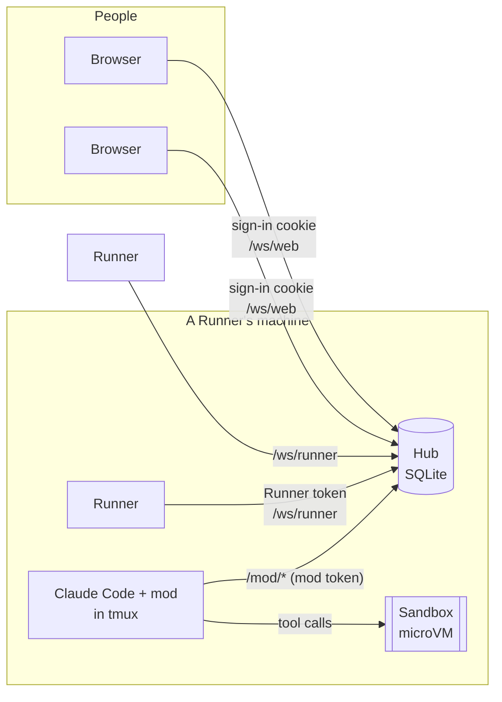

claude-hub lets a team run Claude Code Sessions on their own machines and work in them together from a browser, the way two people pair-program at one screen. It has three kinds of part.

- **The Hub** is the server people sign in to. It keeps every Session, its Events and its Prompt queue in SQLite, and relays prompts and Events between people and Runners. It runs nothing heavy itself: one Bun process.
- **A Runner** is a machine that runs Sessions, on its own Runner login: the Claude account signed in there. It connects out to the Hub over a WebSocket, so the Hub never needs to reach it, and any number can connect.
- **A Sandbox** is a microVM on a Runner, one per Session, where all of the Session's file and command work happens. It is disposable: the Session's Workspace lives on the Runner and is mounted into it.

Everything goes through the Hub. Browsers, Runners and each Session's mod connect to it and never to each other; see the [protocol reference](/reference/protocol/).

## A Session, end to end

A Session is one Claude Code conversation working on one Repo, on its own Work branch. When someone starts one:

1. The browser sends `CreateSession` to the Hub, which picks the Runner (or the one you chose), records the Session and sends the Runner `StartSession` with the Repo, Work branch, Environment and a mod token for this run.
2. The Runner clones the Repo into the Session's Workspace on the Work branch, builds the Repo's Environment if it hasn't yet, and boots the Sandbox from that build with the Workspace mounted at `/workspace`.
3. It starts Claude Code in a tmux session, `hub-<session id>`, with the `hub-link` mod loaded. The mod says hello to the Hub with its mod token.
4. A prompt from any Participant goes to the Hub, into the Session's Prompt queue. When Claude Code is idle, the Hub hands the next prompt to the mod, which submits it to Claude Code as that Participant's prompt.
5. As Claude works, the mod reports each Event (its text, every tool call and result, the Turn's start and end) to the Hub, which redacts Sensitive values and sends them to everyone in the Session.

Because the Hub holds the queue, Participants can send prompts while a Turn runs, and they run in order, one Turn at a time.

## Claude Code on the host, tools in the Sandbox

The obvious design is to run Claude Code inside the Sandbox. claude-hub doesn't, because that puts the Runner login, the Claude credentials, in a VM with whatever code the agent runs.

Instead Claude Code runs on the Runner's host, and only its file and command tools run in the Sandbox ([ADR 0001](/reference/decisions/0001-claude-on-host-tools-in-sandbox/)):

- The mod intercepts Bash, Read, Write, Edit, NotebookEdit, Glob and Grep, and sends each one to the Session's **tool bridge**, a Unix socket in the Session's directory that only the Runner's user can open.
- The Runner keeps one `claude mcp serve` running inside the Sandbox and passes each call to it. That is Claude Code's own tool code, so the model keeps the tools it was trained on, with results in the shapes it expects.
- If the bridge is down, the mod refuses the call: a tool never falls back to the host. Every other tool is denied, and so is the `!` shell shortcut in the prompt box.
- The one exception is WebSearch, which the mod leaves to Claude Code: the search runs at Anthropic, so nothing runs on the host. WebFetch, which would fetch from the host, is denied, and its denial tells Claude to use `curl` through Bash instead. See the [security model](/explanation/security-model/#the-sandbox-is-the-boundary).
- Claude Code itself runs in an empty directory, `<session>/claude`, which is linked to `/workspace` inside the Sandbox, so paths need no rewriting. It starts with a fixed `--tools` list, `--strict-mcp-config` and `--setting-sources ""`, so no hooks, MCP servers or settings from the host or the Repo run on the host.
- Claude still gets the Repo's `CLAUDE.md` and skills, read in the Sandbox. At each start and wake, the Runner copies them out of the Workspace to `<session>/repo`. It resolves their `@` imports inside the Repo and defuses what Claude Code would act on, an `@` or an inline shell command. The mod puts the instructions in Claude's context, and Claude Code loads the skills as a plugin named `repo` ([ADR 0001](/reference/decisions/0001-claude-on-host-tools-in-sandbox/#repo-skills-and-claudemd-amended-in-125)).
- Claude is told about the Sandbox, not the host. Claude Code's own environment note names its directory on the host, the host's platform and OS, and no git repository, so the mod leaves it out. The mod's section of the system prompt names `/workspace` as the working directory, a git checkout of the Repo on the Work branch, Linux and bash instead. It is there from the first request, including in a Session driven only from the web UI, where Claude Code would send its own note late or not at all.

File tools must not run on the host even though the Workspace lives there: a symlink made inside the Sandbox could point a host-side Read at `~/.ssh`.

### Long tool calls

A mod reaches the bridge with Claude Code's own fetch, which gives up after 30 seconds, but a test run or an install can take minutes. So the mod doesn't wait for a call in one request. It starts the call under an id of its own, then asks the bridge for it again and again, each time waiting up to 20 seconds for it to end ([protocol](/reference/protocol/#tool-bridge)). A call runs for as long as its tool allows:

- Bash: its own `timeout`, 2 minutes unless Claude asks for more, and at most 10 minutes, plus 30 seconds for the answer to arrive.
- The other tools: 5 minutes.

When the mod stops waiting, it tells the bridge to cancel the call, and Claude Code's tool server in the Sandbox kills the command. That happens when the call runs past its time, when someone interrupts the Turn, and when Claude Code exits. The bridge cancels a call by itself too, when nothing has asked about it for 30 seconds, and every running call when the Sandbox stops, so a command doesn't outlive the Claude Code that started it.

A refused call says whether it ran. `… so it did not run at all` means the bridge never took it, so it's safe to run again. Once the bridge has taken a call, a failure says `… may have run in this Session's Sandbox, but its result was lost (…). Check before running it again.`: running a command like `git stash pop` twice can do harm. Either way, it never runs on the host. See [Claude's tools are refused](/troubleshooting/sessions/#claudes-tools-are-refused).

### How the Sandbox gets `claude`

`claude mcp serve` needs a Claude Code binary in the Sandbox. The Runner downloads the Linux build of the host's own Claude Code version from the npm registry once, checks it against the registry's integrity hash, keeps it in the home's `claude-code/` ([Files and paths](/reference/files-and-paths/)), and mounts it read-only into every Sandbox at `/opt/claude-hub/claude-code`. There is a musl build, for Alpine-like images, and a glibc build, for Debian, Ubuntu and the like; an Environment's build checks its image and records which one its Sandboxes use.

The Sandbox gets no Claude credentials: `mcp serve` makes no model call.

## Why Sandboxes are disposable

A Session's Workspace, its dependency folders and Docker's data live on disks that outlive the Sandbox ([ADR 0006](/reference/decisions/0006-workspace-on-host-sandbox-disposable/)). So the Runner can stop a Sandbox when the Session goes to sleep, or destroy it and make a new one from a newer Environment build, and nothing is lost:

- **Source** stays in the Workspace, a directory on the Runner mounted at `/workspace`, so the Runner's own git sees every change and can push it as a [WIP ref](/explanation/git-from-sessions/#the-wip-ref).
- **Dependency folders** such as `node_modules`, and package caches, sit on the Session's own disk volumes inside the Sandbox, because many small files are several times slower on a host mount than on a disk.
- **Docker's data**, when the Environment turns Docker on, has its own disk too.

## Several people, one Session

A Session belongs to its Repo, not to a person ([ADR 0003](/reference/decisions/0003-sessions-belong-to-the-repo/)). Anyone with access to the Repo on GitHub can join it ([Who can do what](/explanation/security-model/#who-can-do-what)). Everyone in it is a Participant with the same rights: anyone can prompt it, type into its terminal, put it to sleep or delete it. The person who started it is recorded as its Creator, for history only.

### The terminal mirror

The Session view's **Terminal** tab shows the Session's Claude Code terminal, live. Everyone watching sees the same screen and can type into it: it is the escape hatch for whatever the chat doesn't handle, such as Claude Code's dialogs, Esc and Ctrl-C.

- Opening it asks the Runner for a snapshot of the tmux pane, the whole screen with its colours and cursor, and then relays the pane's output to everyone watching. A reconnect waits for a fresh snapshot, so nothing is drawn twice.
- The terminal has one size, the tmux pane's. Whoever last typed into it or pressed **Fit to my window** sets it; everyone else sees it at that size, scaled down when it doesn't fit.
- The Hub relays keystrokes only from someone who opened the terminal, and only while the Session is Active.

## What runs where

| | Hub's machine | Runner's machine | Sandbox |
|---|---|---|---|
| Sessions, Events, Prompt queues, Environments, Variables | Yes, in SQLite | | |
| The GitHub App's private key | Yes | | |
| Claude Code and the mod, in tmux | | Yes | |
| The Runner login (Claude credentials) | | Yes | Never |
| The Workspace | | Yes, mounted into the Sandbox | at `/workspace` |
| Your Repo's code running: builds, tests, servers | | | Yes |
| A GitHub token for the Session's Repo | | | Yes, in memory ([ADR 0010](/reference/decisions/0010-the-sandbox-gets-a-github-token/)) |
| The Environment's Variables | encrypted, if Sensitive | in memory, while needed | Yes, in each process's environment |

The [security model](/explanation/security-model/) explains what each boundary protects.
