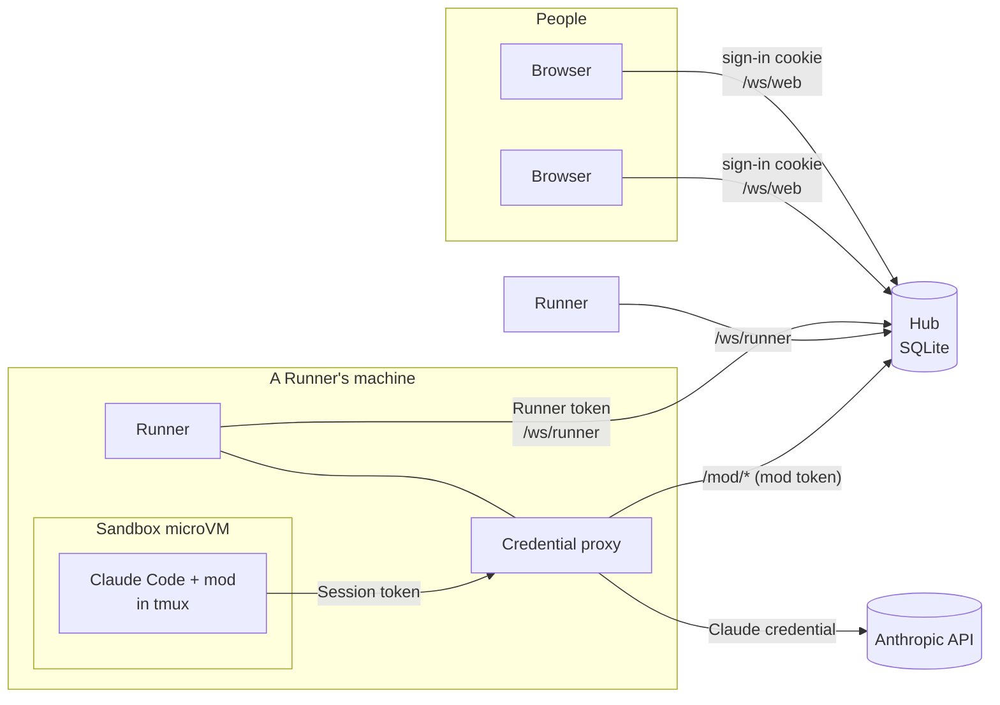

claude-hub lets a team run Claude Code Sessions on their own machines and work in them together from a browser, the way two people pair-program at one screen. It has three kinds of part.

- **The Hub** is the server people sign in to. It keeps every Session, its Events and its Prompt queue in SQLite, and relays prompts and Events between people and Runners. It runs nothing heavy itself: one Bun process.
- **A Runner** is a machine that runs Sessions, each on its Creator's Claude credential, stored on the Hub, or else on the Runner's own Runner login ([ADR 0015](/reference/decisions/0015-each-person-brings-their-claude-credential/)). It connects out to the Hub over a WebSocket, so the Hub never needs to reach it, and any number can connect.
- **A Sandbox** is a microVM on a Runner, one per Session, where the Session's Claude Code runs, and with it every tool, hook and command. It is disposable: the Session's Workspace lives on the Runner and is mounted into it.

Everything goes through the Hub. Browsers, Runners and each Session's mod connect to it and never to each other; a mod reaches it through its Runner's credential proxy. See the [protocol reference](/reference/protocol/).

## A Session, end to end

A Session is one Claude Code conversation working on one Repo, on its own Work branch. When someone starts one:

1. The browser sends `CreateSession` to the Hub, which picks the Runner (or the one you chose), records the Session and sends the Runner `StartSession` with the Repo, Work branch, Environment and a mod token for this run.
2. The Runner clones the Repo into the Session's Workspace on the Work branch, builds the Repo's Environment if it hasn't yet, and boots the Sandbox from that build with the Workspace mounted at `/workspace`.
3. It starts Claude Code in the Sandbox, in a tmux session `hub-<session id>`, with the mod's two plugins loaded: `hub-link` reports to the Hub, and `hub-link-commands` runs the Hub's commands. Each says hello to the Hub through the Runner, which adds the Session's mod token.
4. A prompt from any Participant goes to the Hub, into the Session's Prompt queue. When Claude Code is idle, the Hub hands the next prompt to the mod, which submits it to Claude Code as that Participant's prompt.
5. As Claude works, the mod reports each Event (its text, every tool call and result, the Turn's start and end, and each subagent's) to the Hub, which redacts Sensitive values and sends them to everyone in the Session.

Because the Hub holds the queue, Participants can send prompts while a Turn runs, and they run in order, one Turn at a time.

## Claude Code in the Sandbox

Each Session's Claude Code runs inside its Sandbox, so its tools run where it runs and nothing is routed ([ADR 0013](/reference/decisions/0013-claude-code-runs-in-the-sandbox/)). Bash, Read, Edit, WebFetch, the `!` shortcut, hooks, the Repo's `settings.json`, skills, nested `CLAUDE.md` files and Claude Code's own subagents all behave as they do on a laptop, and all of them stay in the VM.

- **It runs in tmux in the VM,** started through the Sandbox backend's own exec, in `/workspace` with Claude Code's normal setting sources and `--dangerously-skip-permissions` ([ADR 0004](/reference/decisions/0004-the-sandbox-is-the-security-boundary/)). Claude runs as root there, so the Runner sets `IS_SANDBOX=1`.
- **Its state is on a disk of the Session's own,** `/var/lib/claude-hub/claude`, as `CLAUDE_CONFIG_DIR`. The conversation, `--resume` and Claude Code's settings survive sleep. Before each start the Runner seeds it with onboarding done, `/workspace` trusted and bypass-permissions mode accepted, so no dialog waits for a person.
- **It holds no Claude credential.** It sends every request to the Runner's [credential proxy](/explanation/security-model/#the-credential-proxy) with a token for its Session alone, and the proxy puts the real credential in its place. The token is given to the Claude Code process, never written to the VM.
- **The mod loads read-only** from `/opt/claude-hub/hub-link`, each of its plugins with its own `--plugin-dir`, and reaches the Hub through the same proxy, which adds the Session's mod token on the way.
- **Auto memory is off.** Each Session has its own state, so Sessions would never share what it remembers.

### How the Sandbox gets `claude`

The Runner downloads the Linux build of a pinned Claude Code version from the npm registry once, checks it against the registry's integrity hash, keeps it in the home's `claude-code/` ([Files and paths](/reference/files-and-paths/)), and mounts it read-only into every Sandbox at `/opt/claude-hub/claude-code`. There is a musl build, for Alpine-like images, and a glibc build, for Debian, Ubuntu and the like; an Environment's build checks its image and records which one its Sandboxes use.

The version is pinned rather than following the host's, because Claude Code learns its plan from variables that are not a public interface. A new version is pinned only after a smoke test passes: its banner names the plan, `/status` answers, and a Turn runs a Bash command.

Claude Code also needs tmux 3.2 or later and bash in the Sandbox. Every Environment build installs whichever of them its image lacks.

## Why Sandboxes are disposable

A Session's Workspace, its dependency folders and Docker's data live on disks that outlive the Sandbox ([ADR 0006](/reference/decisions/0006-workspace-on-host-sandbox-disposable/)). So the Runner can stop a Sandbox when the Session goes to sleep, or destroy it and make a new one from a newer Environment build, and nothing is lost:

- **Source** stays in the Workspace, a directory on the Runner mounted at `/workspace`, so the Runner's own git sees every change and can push it as a [WIP ref](/explanation/git-from-sessions/#the-wip-ref).
- **Dependency folders** such as `node_modules`, and package caches, sit on the Session's own disk volumes inside the Sandbox, because many small files are several times slower on a host mount than on a disk.
- **Docker's data**, when the Environment turns Docker on, has its own disk too.
- **Claude Code's state**, its conversations and settings, has its own disk, so a woken Session resumes its conversation.

## Several people, one Session

A Session belongs to its Repo, not to a person ([ADR 0003](/reference/decisions/0003-sessions-belong-to-the-repo/)). Anyone with access to the Repo on GitHub can join it ([Who can do what](/explanation/security-model/#who-can-do-what)). Everyone in it is a Participant with the same rights: anyone can prompt it, type into its terminal, put it to sleep or delete it. The person who started it is recorded as its Creator, for history only.

### The terminal mirror

The Session view's **Terminal** tab shows the Session's Claude Code terminal, live. Everyone watching sees the same screen and can type into it: it is the escape hatch for whatever the chat doesn't handle, such as Claude Code's dialogs, Esc and Ctrl-C.

- The Runner attaches to the Session's tmux in the Sandbox in control mode (`tmux -C`). Opening the tab asks it for a snapshot of the pane, the whole screen with its colours and cursor, and then relays the pane's output to everyone watching. A reconnect waits for a fresh snapshot, so nothing is drawn twice.
- The terminal has one size, the tmux pane's. Whoever last typed into it or pressed **Fit to my window** sets it; everyone else sees it at that size, scaled down when it doesn't fit.
- The Hub relays keystrokes only from someone who opened the terminal, and only while the Session is Active.

## What runs where

| | Hub's machine | Runner's machine | Sandbox |
|---|---|---|---|
| Sessions, Events, Prompt queues, Environments, Variables | Yes, in SQLite | | |
| The GitHub App's private key | Yes | | |
| Claude Code and the mod, in tmux | | | Yes |
| The credential proxy | | Yes | |
| Claude credentials | encrypted, if a person stored theirs | Yes, in the proxy's memory; the Runner's own in its Keychain or a file | Never |
| The Workspace | | Yes, mounted into the Sandbox | at `/workspace` |
| Your Repo's code running: builds, tests, servers | | | Yes |
| A GitHub token for the Session's Repo | | | Yes, in memory ([ADR 0010](/reference/decisions/0010-the-sandbox-gets-a-github-token/)) |
| The Environment's Variables | encrypted, if Sensitive | in memory, while needed | Yes, in each process's environment |

The [security model](/explanation/security-model/) explains what each boundary protects.
