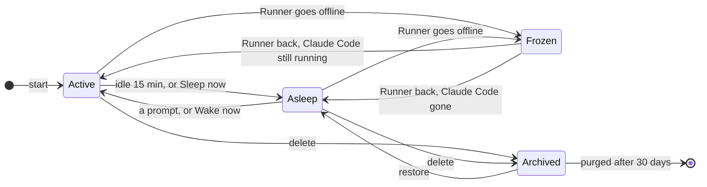

A Session is always in one of four states. The Hub decides which; the Runner does what it asks.

| State | Sandbox | Claude Code | Prompts |
|---|---|---|---|
| **Active** | running | running in tmux | delivered in order, one Turn at a time |
| **Asleep** | stopped, disks kept | stopped | wake it, then wait their turn |
| **Frozen** | whatever the Runner left | whatever the Runner left | wait in the queue until the Runner is back |
| **Archived** | destroyed | stopped | refused; queued ones wait for a restore |

Each Session starts from a base branch onto its own Work branch, `claude/<session id>`.

## Going to sleep

An Active Session with no Turn running, no prompt queued and no Participant present for 15 minutes (the Hub's `HUB_SLEEP_AFTER_MS`) is put to sleep. So is one where someone presses **Sleep now**.

The Runner stops Claude Code, runs `docker stop` on the Sandbox's containers so databases shut down cleanly, and stops the Sandbox, keeping its disks and the Workspace. It pushes the [WIP ref](/explanation/git-from-sessions/#the-wip-ref) first. Only when the Runner reports the Session stopped does the Hub record it Asleep; prompts sent meanwhile wait, and wake it once it is.

## Waking

A prompt to an Asleep Session wakes it, as does **Wake now** on its banner. The Runner starts the same Sandbox again, so `node_modules`, package caches and Docker's data are as they were, and starts Claude Code with `--resume`, which keeps the conversation. Queued prompts are delivered once the mod has said hello.

If the Repo's Environment has a newer version, waking makes the Sandbox afresh from the new build instead, on the same Workspace and disks. **Restart** on a Session's **Environment changed** banner does that at once: it puts the Session to sleep as soon as no Turn is running, and wakes it.

## When a start fails

If Claude Code can't start, for a new Session or a wake, the Session is Asleep, with the Runner's reason in its history. Its queued prompts stay queued and nothing retries on its own: the next prompt, or **Wake now**, tries again. A Claude Code that exits on its own leaves the Session Asleep too.

## Frozen

While its Runner is offline, a Session is Frozen: still readable, with prompts waiting in its queue. Sessions belong to their Runner, because they run on its Runner login, so they wait for it rather than moving elsewhere.

When the Runner is back, the Session is Active if its Claude Code is still running in tmux, which it usually is after a Runner restart, and otherwise Asleep, woken at once if prompts are waiting.

## Deleting and restoring

Any Participant can delete a Session, from the trash button in its header ([ADR 0003](/reference/decisions/0003-sessions-belong-to-the-repo/)). Deleting archives it at once: the Runner stops Claude Code, pushes the WIP ref, and destroys the Sandbox with its disks, keeping the Workspace and Claude Code's state. If the WIP push fails, the archive still completes, with the failure in the Session's history.

An Archived Session is hidden from the sidebar, refuses prompts, and its terminal can't be opened.

- **Undo** on the toast after a delete restores it.
- **Archived Sessions** in the sidebar lists every Repo's Archived Sessions, with who deleted each and when, and a **Restore** button.

A restored Session is Asleep (Frozen while its Runner is offline), and the next prompt wakes it. Its Sandbox was destroyed, so the wake makes a new one on the kept Workspace, and `--resume` keeps the conversation. `node_modules` and Docker's data went with the old disks, so the Start script, or Claude, reinstalls them.

## Purging

30 days after it was archived (the Hub's `HUB_ARCHIVE_RETENTION_MS`), a Session is purged. The Hub deletes its log, Prompt queue and records, and tells its Runner, which deletes the Session's directory (the Workspace, Claude Code's state, the host git directory) and anything left in microsandbox. A Runner that is offline is told when it is back, on every connection until it confirms.

The WIP ref on GitHub is not deleted, so `git fetch origin refs/claude-hub/wip/<session id>` still recovers the Session's last pushed work.

## History

Every start, sleep, wake, delete, restore and failure is in the Session's history with who did it, and shows in its transcript.
