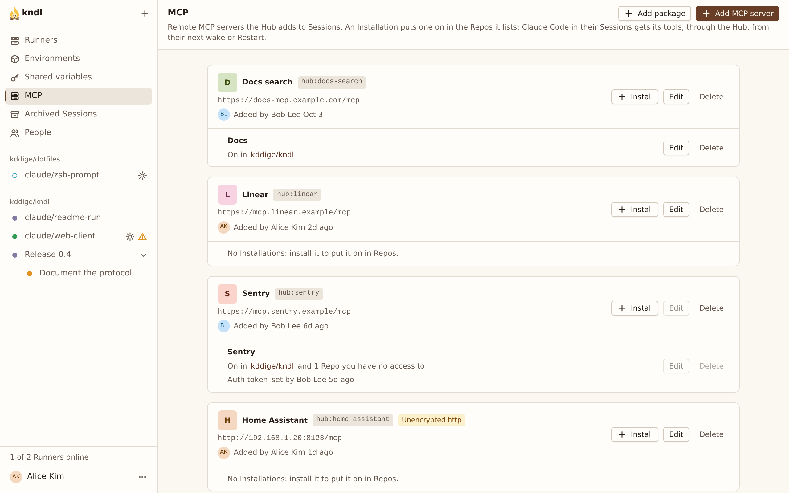

import { CardGrid, LinkCard, Steps } from "@astrojs/starlight/components"

Add a remote MCP server to the Hub and turn it on for your Repos, so the agent in their Sessions can call its tools.

An [MCP server](/reference/glossary/#mcp-server) is added once per Hub. An [Installation](/reference/glossary/#installation) turns it on for the Repos it lists, with its own key.

MCP servers reach every Session through the Hub.

## What you need

- A remote MCP server that speaks [Streamable HTTP](https://modelcontextprotocol.io/specification/2025-06-18/basic/transports#streamable-http) at a URL the Hub can reach, such as `https://mcp.example.com/mcp`.
- If it needs a key, one it takes in an HTTP header. For a sign-in instead, see [Connect an MCP server with OAuth](/guides/connect-an-mcp-server-with-oauth/).
- The Hub's secrets key, `HUB_SECRETS_KEY`, set up: see [Use variables and secrets](/guides/use-variables-and-secrets/#what-you-need).
- Access on GitHub to each Repo you turn it on for.

## Add the MCP server

<Steps>

1. Open **Settings** › **MCP servers**, then press **Add MCP server**.

   

2. Enter a **Name**, such as `Docs search`, and the **MCP server URL**.

3. If the server needs a key, press **Add header secret** under **Header secrets**, and fill in:
   - **Title**: how the key's field is labelled, such as `API key`.
   - **Header**: the HTTP header to send it in, such as `Authorization`.
   - **Value template**: the header's value, with `{value}` where the key goes, such as `Bearer {value}`.

4. Press **Add**.

</Steps>

The MCP server is listed with an id such as `hub:docs-search`. **Edit …**, in its row's **⋯** menu, changes its name, URL or header secrets later.

:::caution
Use `https://`. Over plain `http://` to another machine, the key crosses the network unencrypted. The web UI marks such a server **Unencrypted http**.
:::

## Turn it on for Repos

<Steps>

1. On the MCP server, press **Install**.

2. Enter the **Repos**, one `owner/name` per line.

3. Enter the key in each header secret's field.

4. Press **Add**.

</Steps>

A Repo has at most one Installation of each MCP server. To change which Repos one covers, choose **Edit …** in its **⋯** menu.

### Header secret values

A value is write-only. The Hub encrypts it and adds it to each request, and it never reaches a Runner or Sandbox. To replace one, choose **Edit …** in the Installation's **⋯** menu.

## Turn it on for every Repo

The Hub's [Owner](/reference/glossary/#owner) can tick **Global** on an Installation, to turn it on for every Repo, including new ones. Only the Owner can change a global Installation, since every Session on the Hub can use its key.

Anyone with access to a Repo can turn a global Installation off for that Repo: open the Repo's page and press **Turn off for this Repo** under **MCP servers**.

## Use it in a Session

<Steps>

1. Start a Session on the Repo, or wake one. Running Sessions show **MCP servers changed**: press **Restart** to pick up the server.

2. Ask the agent to use it:

   ```text
   Search the docs for "rate limits".
   ```

</Steps>

The Installations button by the Session's title, such as **1 Installation**, lists what the Session runs with. The agent knows each tool as `mcp__<server>__<tool>`, where `<server>` is the Installation's name as a slug, such as `mcp__docs__search`. They are deferred: the agent finds them with its `tool_search` tool, so a Session with many servers keeps a short tool list.

## Connect it to an account with OAuth

For a server that signs people in, see [Connect an MCP server with OAuth](/guides/connect-an-mcp-server-with-oauth/).

## When an Installation fails a Session

When a Session starts or wakes, the Hub checks each Installation. If one is missing a key, or its server refuses it, the Session stays Asleep and shows **This Session can't start**, with a **Fix** button for each Installation. See [A Session can't start for an Installation](/troubleshooting/hub/#a-session-cant-start-because-of-an-installation).

A server that is only down or slow doesn't stop the Session.

## Delete it

Delete each of the MCP server's Installations first, with **Delete …** in each one's **⋯** menu. Then choose **Delete …** in the MCP server's.

## Next steps

<CardGrid>
  <LinkCard
    title="Connect an MCP server with OAuth"
    href="/kndl/guides/connect-an-mcp-server-with-oauth/"
    description="For servers that sign people in, such as GitHub's."
  />
  <LinkCard
    title="Publish and add an MCP server package"
    href="/kndl/guides/publish-and-add-an-mcp-server-package/"
    description="Describe a server once, for any Hub."
  />
  <LinkCard
    title="MCP servers"
    href="/kndl/reference/mcp-servers/"
    description="Ids, limits, and which edits clear values."
  />
</CardGrid>
