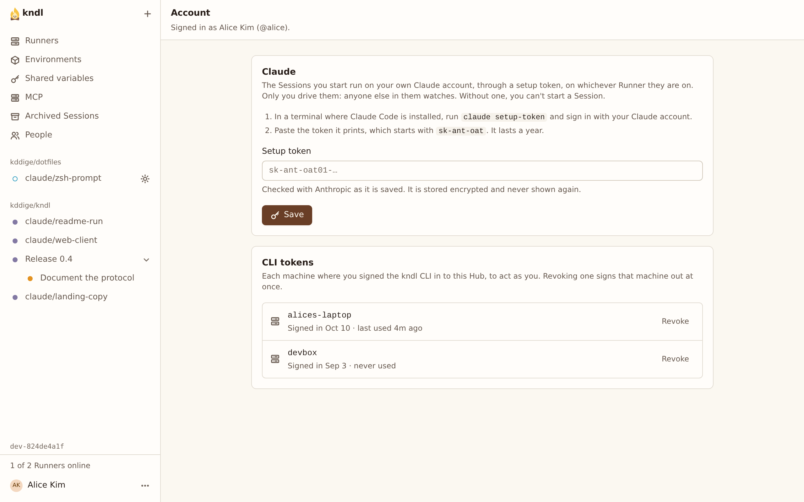

import { CardGrid, LinkCard, Steps } from "@astrojs/starlight/components"

Save your Claude setup token on the Hub once, so every Session you start runs on your own Claude subscription, on any Runner.

You need one to start a Session. A Runner has no Claude credential of its own, so without yours, **New Session** asks you to add it.

## What you need

- **A Claude subscription** (Pro, Max, Team or Enterprise), and Claude Code on any machine.
- **The Hub's secrets key**, `HUB_SECRETS_KEY`, which whoever runs the Hub sets up: see [Use variables and secrets](/guides/use-variables-and-secrets/#what-you-need).

The Hub takes setup tokens only, not Anthropic API keys ([#334](https://github.com/kddige/kndl/issues/334)).

## Add it

<Steps>

1. On any machine with Claude Code, make a token:

   ```sh
   claude setup-token
   ```

   Sign in in the browser it opens. It prints a token starting `sk-ant-oat`, valid for a year. Copy all of it.

2. In kndl, press your name at the bottom of the sidebar, then **Account**.

   

3. Under **Claude**, paste the token, and press **Save**.

</Steps>

The Hub checks the token with Anthropic before it stores it, at no cost. Once saved, the page shows its last 4 characters and when you added it, never the token itself. Claude Code learns your plan from Anthropic, so there's nothing to pick.

If Anthropic rejects it, nothing is stored, and the Hub says why. Make a new token and try again: see [A Claude credential can't be saved](/troubleshooting/sessions/#a-claude-credential-cant-be-saved).

## What it's used for

Only the Sessions you start run on your token, with their subagents, and only you prompt them. Others with access to the Repo watch. See [Several people, one Session](/concepts/architecture/#several-people-one-session).

Your token is in the Claude Code process of each of your awake Sessions, in its Sandbox, so code running there can read it. Start Sessions on Repos you trust. See the [security model](/concepts/security-model/#the-creators-token).

## Replace or remove it

- Press **Replace** to paste a new token, such as when the old one expires.
- Press **Remove** to take it off the Hub.

Either way, your awake Sessions go to sleep, each saying why. A replaced token reaches a Session when you next wake it. After a remove, your Sessions can't wake until you add a token again.

Neither revokes the old token with Anthropic.

## Next steps

<CardGrid>
  <LinkCard
    title="Work in a Session"
    href="/kndl/guides/work-in-a-session/"
    description="Start a Session on your token, and drive it."
  />
  <LinkCard
    title="Security model"
    href="/kndl/concepts/security-model/"
    description="Where your token goes, and who can read it."
  />
</CardGrid>
