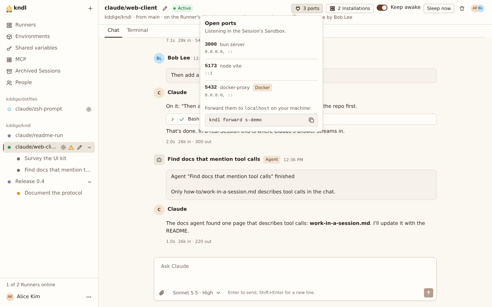

import { CardGrid, LinkCard, Steps } from "@astrojs/starlight/components"

Open a dev server running in a Session at the same port on `localhost` on your machine, so redirects, cookies and `curl` work as they would locally.

## What you need

- The `kndl` command on your machine, [installed from a Hub](/guides/install-the-cli-from-a-hub/) and [signed in](/guides/sign-in-the-cli/).
- A Session with something listening in it, such as a dev server.

## See a Session's Open ports

While something listens on a port in an Active Session, its header shows how many, such as **3 ports**. Press it to see each port, the process holding it, and the `kndl forward` command for the Session.



## Forward a Session

<Steps>

1. On your machine, run:

   ```sh
   kndl forward
   ```

2. Pick the Session with the arrow keys, and press Enter:

   ```
   Forward which Session?
   > 0b9256  claude/fix-login  owner/name  3000, 5173
     77ab12  Docs  owner/name  no open ports
   Up and down to choose, Enter to forward, Esc to quit
   ```

3. The CLI lists each port it forwards:

   ```
   Forwarding 0b9256 claude/fix-login · owner/name · Active
     http://localhost:3000    bun server · 1 connection
     http://localhost:5173    node vite
   Esc: forward another Session · Ctrl-C: stop
   ```

4. Open `http://localhost:5173` in your browser.

</Steps>

Ports that open or close in the Session later are added and removed as they do. **Esc** goes back to the picker. **Ctrl-C** stops forwarding.

## Skip the picker

Name the Session by its id, the start of its id, or its URL:

```sh
kndl forward 0b9256
```

## Choose the ports

Forward only some ports by naming them after the Session:

```sh
kndl forward 0b9256 5173 3000
```

Forward a Session's port to a different port on your machine with `<session port>:<local port>`:

```sh
kndl forward 0b9256 3000:3100
```

An app that redirects to its own address, as an OAuth sign-in does, only works on the same port.

## Let other devices reach it

By default, only your machine reaches the ports. To let a phone or another device on your network reach them, pass `--bind`:

```sh
kndl forward 0b9256 --bind 0.0.0.0
```

:::caution
Anyone who can reach that address on your network can use the ports, without signing in to the Hub.
:::

## While it forwards

- The Session shows you in **Here now** as forwarding from your machine.
- The Session stays awake while a forward is connected, and an Asleep Session wakes when you forward it.
- If the connection to the Hub drops, the CLI reconnects on its own.

If a port is already taken on your machine, the CLI says which process holds it and keeps retrying. See [Commands](/reference/commands/#kndl-forward) for every option.

## Next steps

<CardGrid>
  <LinkCard
    title="Install the CLI from a Hub"
    href="/kndl/guides/install-the-cli-from-a-hub/"
    description="Get the kndl command on your laptop."
  />
  <LinkCard
    title="Manage a Session"
    href="/kndl/guides/manage-a-session/"
    description="Keep a Session awake for a dev server."
  />
</CardGrid>
