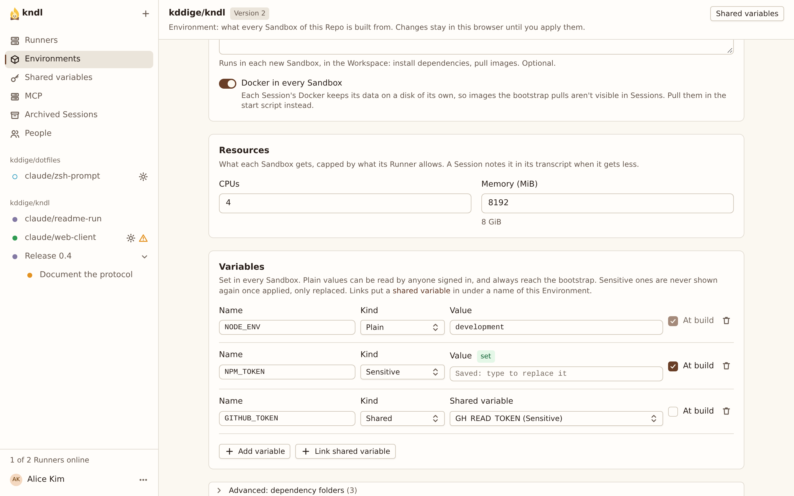

import { CardGrid, LinkCard, Steps } from "@astrojs/starlight/components"

Give a Repo's Sessions settings and secrets as environment variables, and share a value across Repos.

A [Variable](/reference/glossary/) reaches the Start script and every tool the agent runs in the Repo's Sandboxes. With **At build**, it reaches the Bootstrap script too.

## What you need

- **To store Sensitive values, the Hub needs a secrets key.** Whoever runs the Hub makes one with `kndl secrets key` and sets it as `HUB_SECRETS_KEY` in `~/.kndl/hub.env`. Without it, the Hub refuses to save a Sensitive value.

:::danger[Back up the key with the database]
Sensitive values can't be read without the key that saved them, and the Hub won't start without it. See [If the key is lost](#if-the-key-is-lost).
:::

## Add a variable

<Steps>

1. Open the Repo's Environment, and under **Variables**, press **Add variable**.

   

2. Give it a **Name**, such as `NPM_TOKEN`: letters, digits and underscores, not starting with a digit.

3. Pick its **Kind**:
   - **Plain** for settings, such as `NODE_ENV`. Anyone signed in can read it.
   - **Sensitive** for tokens and keys. Nobody can read it back once it's applied, only replace it, and its value is masked in Session output.

4. Tick **At build** if the Bootstrap script needs it, such as a token for a private package registry.

5. Apply the Environment. A change to a variable available at build needs a Test build first.

</Steps>

## Share a value across Repos

To use one value, such as an `NPM_TOKEN`, in many Repos, make it a shared variable:

<Steps>

1. Press **Shared variables** in the sidebar, and add the variable once.

2. In each Repo's Environment, press **Link shared variable**, pick it, and give it the name that Environment should see.

</Steps>

Changing a shared value changes it in every Environment that links it. It can't be deleted while any Environment links it.

## What masking covers

The Hub masks each Sensitive value as `*` in prompts, the agent's replies, tool calls, the terminal and Test build logs. It can't catch a value that a tool changed before printing, such as base64-encoded. A value a script writes to disk, such as in an `.npmrc`, stays on that disk.

See [Security model](/concepts/security-model/#redaction) for how values are stored and passed to Runners.

## If the key is lost

The values the key encrypted are lost with it. Whoever runs the Hub resets them with `kndl secrets reset`, sets a new key, and starts the Hub again: see [The secrets key is lost](/troubleshooting/hub/#the-secrets-key-is-lost).

Afterwards, each cleared variable keeps its name and settings, and shows **needs a value**. Type each value again on the Repo's Environment, or press **Enter value** on **Shared variables**. Until then, the Repo's Sessions don't start.

## Next steps

<CardGrid>
  <LinkCard
    title="Set up an Environment"
    href="/kndl/guides/set-up-an-environment/"
    description="The scripts that use the variables."
  />
  <LinkCard
    title="Security model"
    href="/kndl/concepts/security-model/#redaction"
    description="Where Sensitive values go, and where they don't."
  />
</CardGrid>
