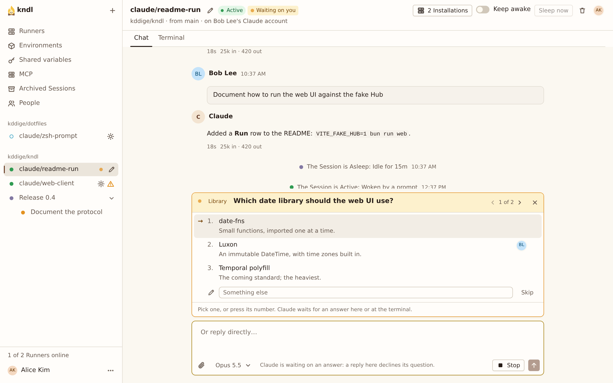

import { CardGrid, LinkCard, Steps } from "@astrojs/starlight/components"

Start a Session on a Repo, drive it while your team watches, and get its work onto GitHub.

## What you need

- An account on a Hub with at least one online Runner.
- Your [Claude credential](/guides/add-your-claude-credential/) on your **Account** page. The Sessions you start run on it.
- A Repo with an [Environment](/guides/set-up-an-environment/). Starting the first Session on a Repo takes you there.

## Start a Session

<Steps>

1. Press **New Session**, at the top of the sidebar.

2. Pick the **Repo**, or type it as `owner/name`. **Branch** fills in with the Repo's default branch.

3. Choose where Claude commits:
   - Leave **Work on a new branch** on to commit to a new branch, `claude/<session id>`.
   - Turn it off to commit to the branch itself.
   - Type a new name and pick **Create branch '…'** to start a branch of your own.

4. Leave **Runner** on **Any online Runner**, and press **Start Session**.

   The Session opens with a **Starting…** banner. **Show log** follows the Runner as it clones the Repo and boots the Sandbox.

</Steps>

## Prompt it while others watch

You started the Session, so you drive it. Everyone else with access to the Repo can open it and follow along live, but can't prompt it: their prompt box says who drives.

- **While Claude works**, new prompts wait in the [Prompt queue](/reference/glossary/) and run in order.
- **To get a queued prompt in now**, press **Steer** on it. Claude reads it at its next step, usually after the current tool call, and the transcript marks it **Steered in**.
- **To stop the Turn**, press **Stop** in the prompt box. A running Bash command moves to the background instead of being killed.

Claude never asks for permission to run a tool. Everything it runs stays in the Session's Sandbox: see [Security model](/concepts/security-model/).

## Answer Claude's questions

When Claude asks a question, the Session's row gets an amber dot and its header says **Waiting on you**. A card above the prompt box asks the questions one at a time.



- Click an option, or press its number.
- Type your own answer in **Something else** and press Enter.
- Press **Skip** to leave a question unanswered.

You answer, and everyone in the Session sees your picks. The answers go to Claude after the last question. To reply in your own words, type in the prompt box (**Or reply directly…**) and press **Reply**.

## Use the terminal

The **Terminal** tab shows Claude Code's screen, live, and you can type into it. Use it for what the chat doesn't cover: Claude Code's other dialogs, a subagent's questions, Esc and Ctrl-C.

Only you see it. Others in the Session don't, since the terminal is where your Claude token is easiest to see. **Fit to my window** sets its size to yours.

## What Claude can use

Claude Code runs in `/workspace`, the Repo's checkout. The Repo's own `CLAUDE.md`, `.claude/` skills, agents, commands, hooks and settings, and `.mcp.json` apply as they would on your machine. Settings on the Runner's machine never apply.

The Hub can add more MCP servers to every Session on a Repo: see [Add a remote MCP server](/guides/add-a-remote-mcp-server/).

## Get the work out

Ask Claude to commit, push and open a pull request:

```text
Commit this, push the branch and open a pull request.
```

Claude uses `git` and `gh` once the Hub has its GitHub App: see [Git from Sessions](/concepts/git-from-sessions/).

:::caution
Until it's pushed, the work exists only in the Session's Workspace on the Runner. If that machine's disk is lost, so is the work.
:::

## Next steps

<CardGrid>
  <LinkCard
    title="Manage a Session"
    href="/kndl/guides/manage-a-session/"
    description="Rename it, change its model, keep it awake, delete and restore it."
  />
  <LinkCard
    title="Work with subagents"
    href="/kndl/guides/work-with-subagents/"
    description="Follow, message and stop the agents a Session starts."
  />
  <LinkCard
    title="Forward a Session's ports"
    href="/kndl/guides/forward-a-sessions-ports/"
    description="Open a Session's dev server on localhost on your machine."
  />
  <LinkCard
    title="Session lifecycle"
    href="/kndl/concepts/session-lifecycle/"
    description="Active, Asleep, Frozen and Archived, and what each keeps."
  />
</CardGrid>
