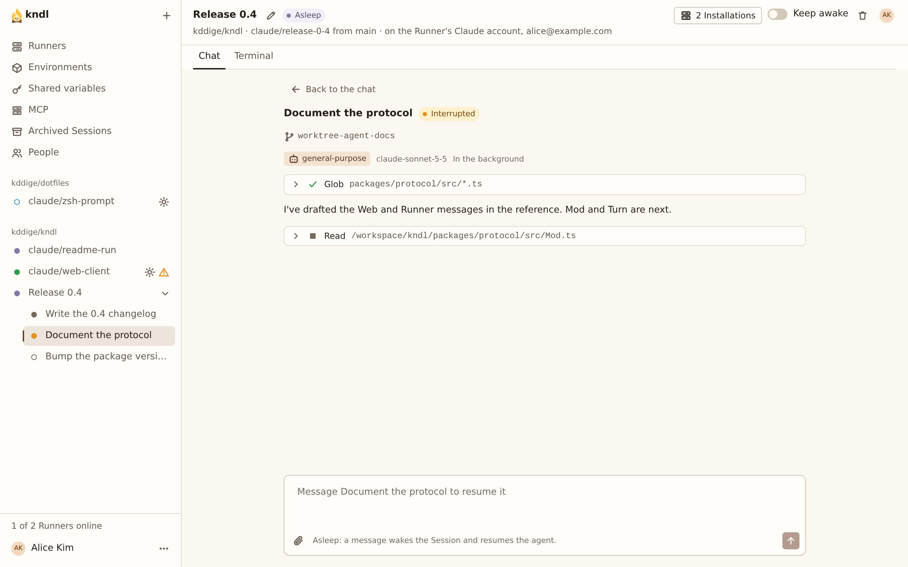

import { CardGrid, LinkCard, Steps } from "@astrojs/starlight/components"

Have a Session hand work to [subagents](/reference/glossary/), then follow, message, stop and resume them from the web UI. Everyone in the Session follows them, and can message, stop and resume them.

## What you need

- A Session: see [Work in a Session](/guides/work-in-a-session/).

## Ask for subagents

Ask for them in a prompt:

```text
Use one agent to find every caller of parseConfig, and another to draft the changelog.
```

Each agent runs on the Session's Model, or on any other of the Creator's the prompt names. By default it runs in the background: the Turn can end while it works, and when it's done its result starts a new Turn, shown as from the agent. A result that comes while a Turn runs waits for that Turn to end. Several agents run side by side.

The Session's agent can also wait for one, when it can't go on without its answer, and it can message, stop and resume its agents itself. A subagent can't start agents of its own or ask anyone questions.

Every agent shares the Session's Sandbox. If they need more CPU or memory, raise the [Environment's resources](/guides/set-up-an-environment/#set-the-resources).

## Follow an agent

Each agent is a card in the transcript that streams its work. In the sidebar, the Session's agents are listed under its row, each with a status:

| Status      | Meaning                                                     |
| ----------- | ----------------------------------------------------------- |
| Running     | The agent is working.                                       |
| Done        | The agent finished.                                         |
| Stopped     | Someone in the Session, or the Session's agent, stopped it. |
| Interrupted | The Session's agent stopped while this one ran.             |

To open an agent's view, click its row in the sidebar, or **Message or stop it** on its card. **Back to the chat** returns to the transcript.



## Message, stop or resume an agent

In the agent's view:

<Steps>

1. **To message a running agent**, type in the box and press **Send message**. The agent reads it, with your name, at its next tool call.

2. **To stop it**, press **Stop agent**. The Session's agent is told it stopped.

3. **To resume an agent** that is Done, Stopped or Interrupted, type what it should do and press **Resume**. It picks up where it left off, with its whole conversation, which costs less than starting a new agent. A message to an agent of an Asleep Session wakes the Session first.

</Steps>

When a resumed agent is done, its result starts a Turn, as when it was started. You can also ask the Session's agent to message or resume one for you.

**Stop** on a Turn doesn't stop a background agent. Stop it from its view. An agent the Session's agent is waiting for stops with that Turn.

## After sleep or a restart

Subagents survive their Session's agent stopping. While it is stopped, on sleep, a restart or a lost Runner, running agents show as Interrupted. When the agent starts again, they go on where they were, and their results still come. Every agent's conversation is kept with the Session, so any of them, Done, Stopped or Interrupted, can be resumed after the Session wakes. While agents run, **Sleep now** and a restart ask first, and the Session doesn't fall asleep on its own.

A subagent started in a [Thread](/guides/reply-in-a-thread/) reports to the Thread.

## Next steps

<CardGrid>
  <LinkCard
    title="Manage a Session"
    href="/kndl/guides/manage-a-session/"
    description="Sleep, wake and model changes, which interrupt agents."
  />
  <LinkCard
    title="Set up an Environment"
    href="/kndl/guides/set-up-an-environment/"
    description="Give agents more CPUs and memory."
  />
</CardGrid>
