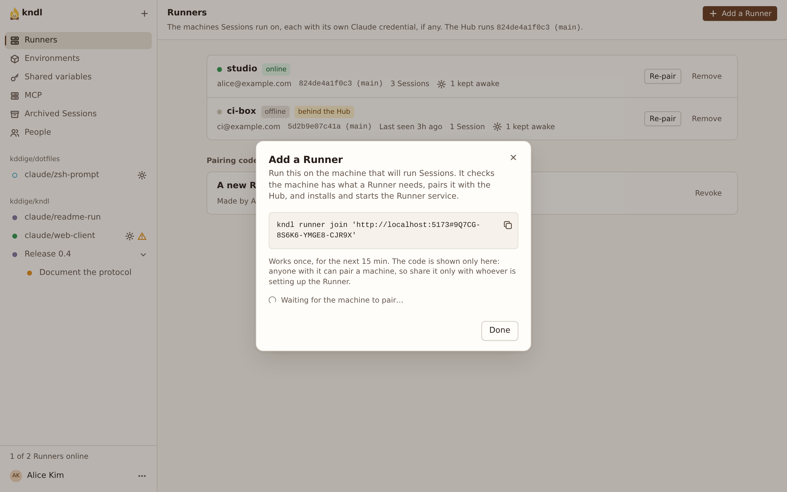
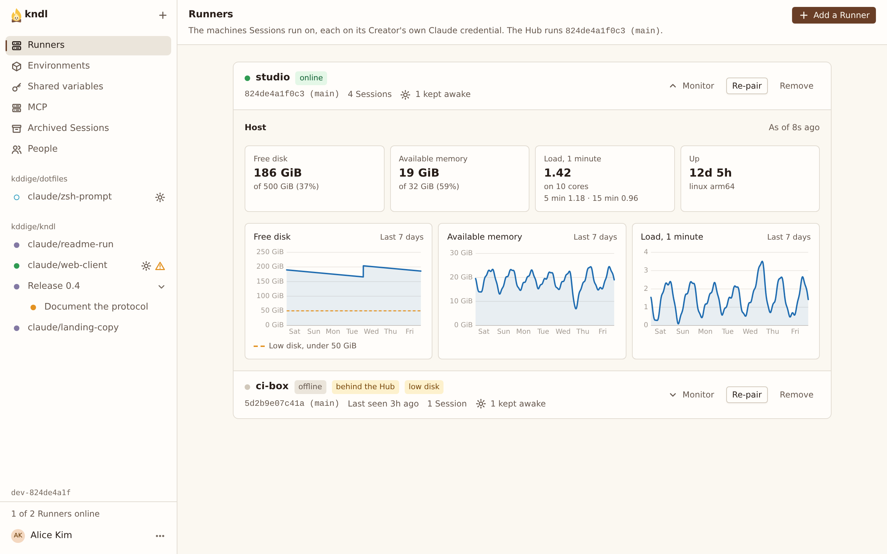

import { CardGrid, LinkCard, Steps } from "@astrojs/starlight/components"

Connect a machine to the Hub as a Runner, so Sessions can run on it.

Each Runner connects out to the Hub, so the Hub never reaches into it. A Runner needs no Claude Code, no Node.js and no sign-in at any Provider: its Sessions run on their Creator's [Connected providers](/guides/connect-your-providers/).

## What you need

- A machine with what a Runner [needs](/self-hosting/install/#what-each-machine-needs): a Mac with Apple Silicon, or Linux with KVM.
- The Hub's URL, reachable from that machine. See [Reach the Hub from other machines](/self-hosting/reach-the-hub-from-other-machines/).

## Pair it from the web UI

Anyone signed in can add a Runner.

<Steps>

1. In the web UI, open **Settings** › **Runners** and press **Add a Runner**. Copy the command it shows.

   

2. On the **Runner's machine**, [install kndl](/self-hosting/install/#install), then paste the command:

   ```sh
   kndl runner join 'https://hub.example.com#7K2QD-M9XRT-4VBNC-H8PWE'
   ```

   It offers to install what's missing, installs and starts the Runner's service, and waits until it connects.

3. The dialog's **Waiting for the machine to pair…** turns into **Paired build-box**, and the Runner shows on the **Runners** page.

</Steps>

The Runner is named after the machine's short hostname. To name it yourself, add `--name build-box`. For a script, add `--non-interactive`.

### Pairing codes

- A code works **once**, within **15 minutes**, and is shown only once.
- Anyone with it can pair a machine, so share it only with whoever sets up the Runner.
- **Pairing codes not used yet**, on the **Runners** page, lists open codes. **Revoke the code**, in a code's **⋯** menu, ends it. A Runner already paired keeps working.
- Case, dashes and spaces don't matter, so a code read aloud works.

## Pair it with a Runner token

To script it from the Hub's machine, issue a token instead.

<Steps>

1. On the **Hub's machine**, issue the Runner's token. It starts with `chr_` and isn't shown again:

   ```sh
   kndl runner token build-box
   ```

2. On the **Runner's machine**, install kndl and run onboard with it:

   ```sh
   kndl onboard --role runner --runner-name build-box \
     --hub-url https://hub.example.com --token chr_…
   ```

</Steps>

## Manage Runners

The **Runners** page lists each Runner: online or offline, its version, and its Sessions. A Runner has no account at a Provider of its own: each Session runs on its Creator's.



Each row's **⋯** menu holds what you can do to the Runner, named after it, such as **Re-pair build-box**:

- **Monitor** opens the Runner's host under its row, as a click on the row does: free disk, available memory, load and uptime as it last sampled them, and charts of the last 7 days. A row says **low disk** when under 10 GiB, or a tenth of the disk, is free. Sessions still start; it's a warning.
- **Re-pair** makes a code for that Runner. The machine that uses it takes the Runner's place, with its name and Sessions, and the old token stops working. Use it for a reinstalled machine or a lost token.
- **Remove** disconnects the Runner and revokes its token. Archive its Sessions first.

While a Runner is offline, its Sessions are [Frozen](/concepts/session-lifecycle/#frozen). They carry on when it's back. `kndl runner stop` and `kndl runner start` control its service, and `kndl logs runner -f` follows its log.

### Runner names

A Runner's name is its identity: its Sessions belong to the Runner of that name.

- **A name the Hub has** can't be taken by a new Runner. `kndl runner join` refuses with `The Hub already has a Runner named build-box …`, and the code isn't used up. Use **Re-pair** in its **⋯** menu instead.
- **A removed Runner's name** is free again. A machine paired under it takes over the removed Runner's Archived Sessions.
- **For a clean slate**, pair under a new name: `--name build-box-2`.

## What a Runner downloads

A Runner gets the pinned versions of what Sessions run the first time it needs them, and keeps them for every later start. Each is mounted read-only into every Sandbox.

| What                                               | When                                       | From                                                                                   | Kept in              |
| -------------------------------------------------- | ------------------------------------------ | -------------------------------------------------------------------------------------- | -------------------- |
| Pi Durable and its packages, which the agent loads | As the Runner starts                       | The npm registry, installed with Bun                                                   | `<home>/pi`          |
| Node.js, which the agent runs on                   | As the Runner starts                       | `nodejs.org` and `unofficial-builds.nodejs.org`, a build for each C library images use | `<home>/pi`          |
| Claude Code, which runs Claude's Models            | At the first Session that needs each build | The npm registry                                                                       | `<home>/claude-code` |

The first start takes a few seconds more while it gets Pi Durable's packages. Its log then says `Sessions can run the durable agent on pi …`. If it can't, its log says `Sessions can't run: …`, and it runs no Sessions until it next starts: see [A Runner can't run the agent](/troubleshooting/sessions/#a-runner-cant-run-the-agent).

`RUNNER_SANDBOX_PI_CACHE` and `RUNNER_SANDBOX_CLAUDE_CACHE` move the caches: see [Configuration](/reference/configuration/#runner).

## Keep Runners on the Hub's commit

Runners run the Hub's commit, and follow it when the Hub updates. A Runner **behind the Hub** starts and wakes no Session until it updates. See [Update kndl](/self-hosting/update/#keep-runners-on-the-hubs-commit).

## Next steps

<CardGrid>
  <LinkCard
    title="Let people in"
    description="Become the Hub's Owner and invite your team."
    href="/kndl/self-hosting/let-people-in/"
  />
  <LinkCard
    title="Set up an Environment"
    description="Give a Repo's Sandboxes the tools its Sessions need."
    href="/kndl/guides/set-up-an-environment/"
  />
</CardGrid>
