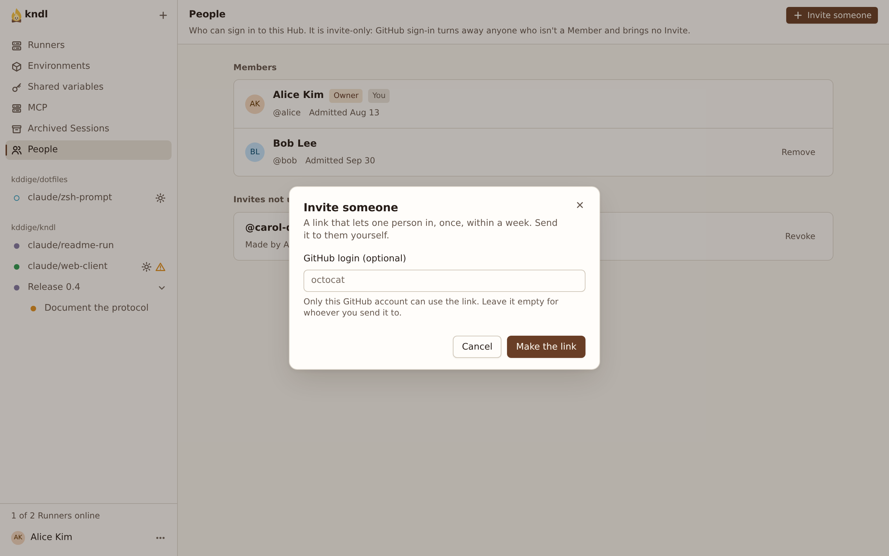
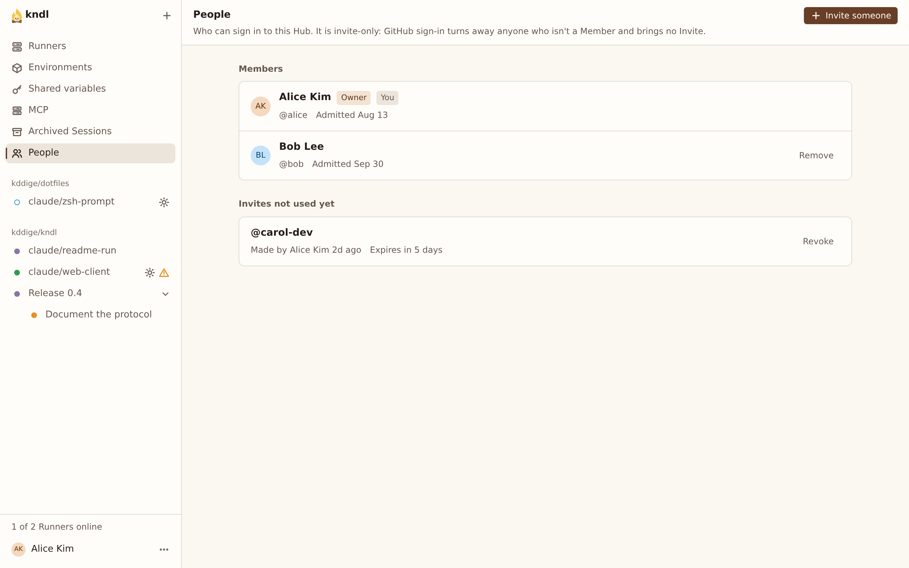

import { CardGrid, LinkCard, Steps } from "@astrojs/starlight/components"

Become the Hub's Owner, then invite your team.

A Hub with GitHub sign-in lets in only its Owner and the people the Owner invites, its Members ([ADR 0019](/contributing/decisions/0019-invites-decide-who-gets-in/)). Being a Member opens no Repo: each Member sees the Repos they reach on GitHub. With dev login, anyone who reaches the Hub signs in, and none of this applies.

## What you need

- A Hub with [GitHub sign-in](/self-hosting/set-up-the-github-app/).

## Become the Owner

Until it has an Owner, the Hub lets in only whoever brings its Setup link. `kndl onboard` prints it at the end:

```
The Hub has no Owner yet. Its Setup link, shown only now:

  https://hub.example.com/setup#cho_…
```

<Steps>

1. Open the link in your browser.

2. Press **Continue with GitHub**, and sign in as the account that should own the Hub.

</Steps>

You're signed in as the Owner, and the link stops working. Keep it secret until then: whoever opens it first becomes the Owner.

To print a new link on the **Hub's machine**, replacing the old one:

```sh
kndl hub setup-link
```

## Invite someone

The **People** page is the Owner's alone.

<Steps>

1. Open **People** and press **Invite someone**.

   

2. To limit the Invite to one GitHub account, type its login, such as `octocat`. Leave it empty for anyone with the link.

3. Press **Make the link**, then **Copy link**, and send it yourself. kndl sends no email.

</Steps>

The link admits one person, once, within 7 days. They open it, press **Continue with GitHub**, and they're a Member. Give them a Repo to work in: [install the App](/self-hosting/set-up-the-github-app/#install-the-app) on theirs, or add them to yours.

**Invites not used yet** lists each open Invite. **Revoke** ends one at once.



## Remove a Member

Under **Members**, press **Remove** beside someone. At once:

- They're signed out of the web UI everywhere, and their CLI tokens are revoked.
- They can't sign in again without a new Invite.

A port Forward they have open stays open until it closes, and a Pairing code they made works until it expires.

Their Sessions stay, and run on their Claude credential. The Owner can't be removed. Apart from the **People** page, Members can do what the Owner can, such as adding and removing Runners.

## Make the GitHub App public

A private App installs only on the account that owns it. To serve Repos across several accounts, open the App's settings on GitHub, then **Advanced**, and press **Make public**. Anyone can then install the App, but only Members get in, and each sees only the Repos they reach.

## Next steps

<CardGrid>
  <LinkCard
    title="Add a Runner"
    description="Pair another machine with the Hub."
    href="/kndl/self-hosting/add-a-runner/"
  />
  <LinkCard
    title="The security model"
    description="Who can do what, and what a Sandbox reaches."
    href="/kndl/concepts/security-model/"
  />
</CardGrid>
