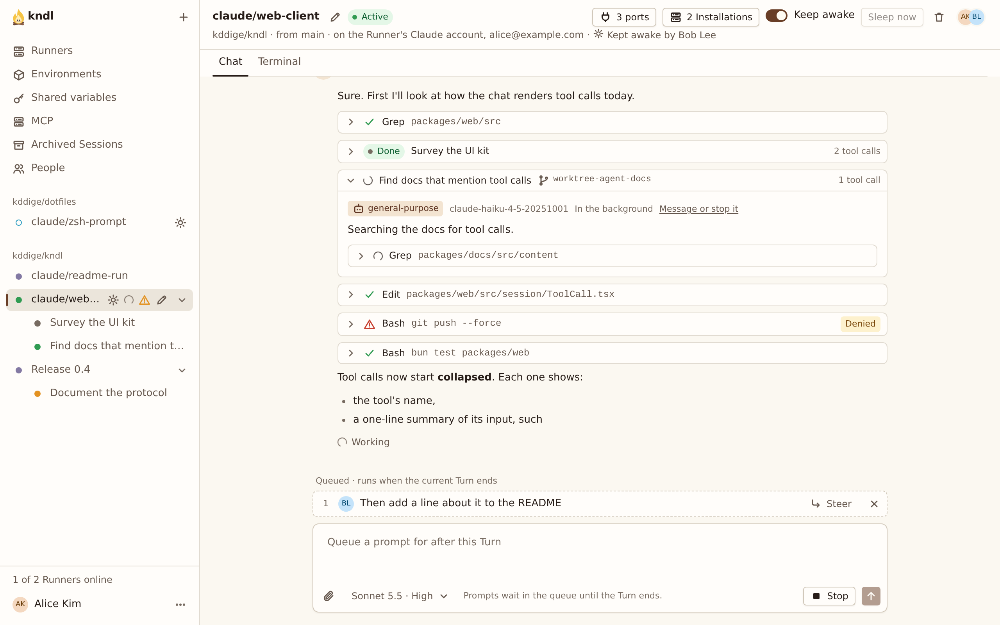

import { CardGrid, LinkCard } from "@astrojs/starlight/components"
import HowItWorks from "../../../components/HowItWorks.astro"

kndl (said "kindle") runs coding-agent Sessions on machines you own, on the Models of any Provider you connect. Whoever starts a Session drives it, and your team watches it live from the browser.

## What you get

- **Shared Sessions.** Everyone with access to a Repo can open its Sessions and follow the agent live. A Session's [Creator](/reference/glossary/#creator) drives it: their prompts sent while Claude works wait in a [Prompt queue](/reference/glossary/#prompt-queue), or join the running Turn with **Steer**.
- **A Sandbox per Session.** The agent and every command it runs live in a microVM on a Runner, never on the host.
- **Your machines.** The Hub and the Runners are yours: a laptop, a Mac mini under a desk, a Linux server. Nothing runs on a kndl service, because there isn't one.
- **Your own accounts, any Provider.** Each person connects their own [Providers](/guides/connect-your-providers/): a ChatGPT or GitHub Copilot sign-in, an API key, or a Claude setup token. The Sessions they start run on them, on any Runner, and switch Model mid-conversation. Nobody else's prompts reach them.

## How it fits together

<HowItWorks />

- **The Hub** is one Bun process with a SQLite database. It serves the web UI, signs people in with GitHub, and keeps every Session.
- **A Runner** is a machine that runs Sessions: a Mac with Apple Silicon, or Linux with KVM. It connects to the Hub, so the Hub needs no access to it.
- **A Sandbox** is the microVM a Session runs in, built from its Repo's [Environment](/concepts/environments/): an image and a setup script.

One machine can be the Hub and a Runner at once. That's how the [Quickstart](/start/quickstart/) runs it.

## Who it's for

- **You, trying it.** Install it on one machine, start a Session on one of your Repos, and remove it with one command if it isn't for you.
- **A team.** Run the Hub on a server, add a Runner or two, and invite the people who work on your Repos.

## What it isn't

- **Not a hosted service.** You run every part. There's no account to make and nothing to pay kndl for.
- **Not a fork of an agent.** kndl runs [pi](https://pi.dev) and Claude Code as their makers publish them, on your own accounts and under each Provider's terms.
- **Not affiliated with Anthropic.** kndl is an independent open-source project. Claude and Claude Code are trademarks of Anthropic, PBC.
- **Not finished.** kndl is early. Expect settings to change between [Releases](/self-hosting/install/#update).

## Next steps

<CardGrid>
  <LinkCard
    title="Quickstart"
    description="Run kndl on one machine and start a Session, in about 10 minutes."
    href="/kndl/start/quickstart/"
  />
  <LinkCard
    title="Deploy for a team"
    description="Put a Hub on a server, add Runners and invite people."
    href="/kndl/start/deploy-for-a-team/"
  />
  <LinkCard
    title="How kndl works"
    description="The Hub, Runners, Sandboxes, and who drives a Session, in detail."
    href="/kndl/concepts/architecture/"
  />
</CardGrid>
