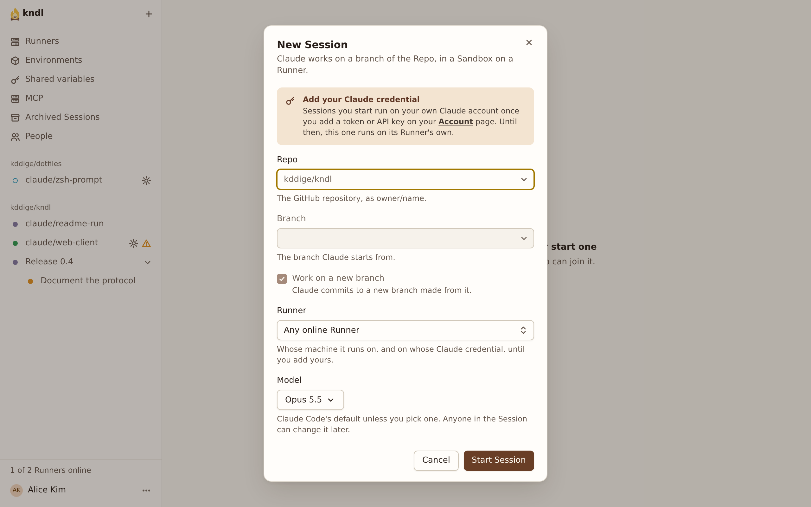
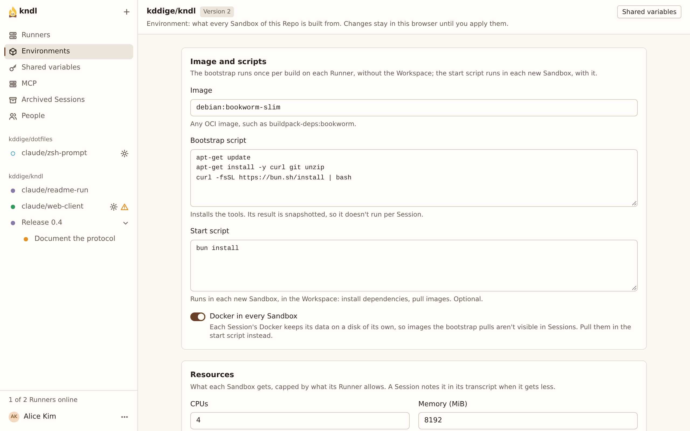
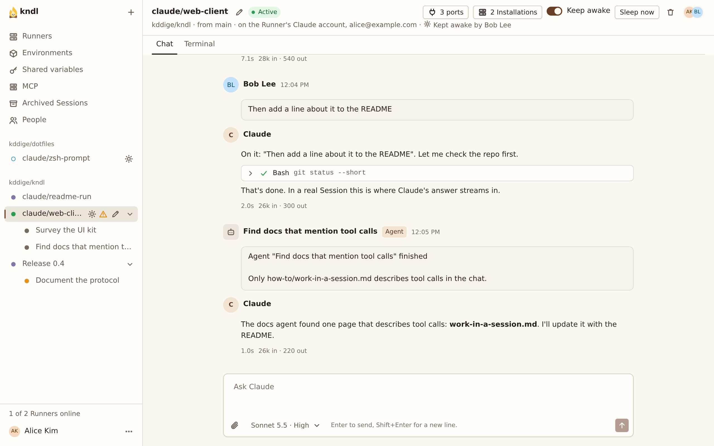

import { CardGrid, LinkCard, Steps } from "@astrojs/starlight/components"

Run a Hub and a Runner on one machine, start a Session on one of your Repos, and remove it all when you're done. It takes about 10 minutes, most of it waiting for the first Sandbox to build.

## What you need

- **A Mac with Apple Silicon, or Linux with KVM.** Each Session runs in a [microsandbox](https://github.com/microsandbox/microsandbox) microVM, which needs one of the two.
- **git and curl.** The installer adds [Bun](https://bun.sh) if it's missing.
- **An account at a Provider,** such as a ChatGPT or GitHub Copilot subscription, or an API key. For Claude, a Claude subscription and Claude Code on any machine, to make a setup token. You connect it after installing.
- **A GitHub repository** this machine can clone. Any public repository works.

## Install and set up

<Steps>

1. Install kndl:

   ```sh
   curl -fsSL https://raw.githubusercontent.com/kddige/kndl/main/install.sh | sh
   ```

   It clones kndl into `~/.kndl`, puts the `kndl` command in `~/.local/bin`, and prints what to run next.

2. Start onboard:

   ```sh
   kndl onboard
   ```

   If your shell says `kndl: command not found`, open a new terminal, or run `~/.local/bin/kndl onboard`. Then answer its questions:

   | Question                                                                               | Answer                                                |
   | -------------------------------------------------------------------------------------- | ----------------------------------------------------- |
   | What does this machine run?                                                            | **Both: a Hub, and a Runner for it, on this machine** |
   | Who reaches this Hub?                                                                  | **Only this machine (127.0.0.1)**                     |
   | Sign in without GitHub (dev login, this machine only), until the GitHub App is set up? | Yes                                                   |
   | GitHub sign-in, and Repos' tokens, need a GitHub App. Set it up now?                   | **Not now**                                           |
   | Run these now? (only if something is missing)                                          | Yes. It lists the commands first; some use `sudo`.    |
   | Keep the services running while you're logged out…? (Linux only)                       | Your choice. No is fine for a try.                    |

   Onboard writes the settings, installs the Hub and the Runner as services, and checks that the Runner connects. You should see it end with `Done.`

   To skip the questions, pass the answers as flags instead: `kndl onboard --role both --reach local --dev-login --github-app skip`.

3. Open [http://127.0.0.1:7777](http://127.0.0.1:7777). Under **Dev login**, type a name, such as `alice`, and press **Sign in as dev**.

</Steps>

## Connect a Provider

Press your name at the bottom of the sidebar, then **Account**. Under **Providers**, sign in with a subscription or paste an API key: see [Connect your Providers](/guides/connect-your-providers/). For Claude's Models, add your setup token under **Anthropic**: see [Add your Claude credential](/guides/add-your-claude-credential/).

## Start a Session

<Steps>

1. Press **New Session**. In **Repo**, enter your repository as `owner/name`. Leave **Branch** on its default branch, **Runner** on **Any online Runner** and **Model** on the Model it shows, then press **Start Session**.

   

2. A Repo's first Session needs an [Environment](/concepts/environments/): what its Sandboxes are built from. kndl opens the Repo's Environment page with a draft. Leave the defaults.

   

3. Under **Apply**, pick your Runner in **Runner to build on** and press **Test build**. The log streams in below. The first build pulls the image, so it takes a few minutes.

4. When the build passes, press **Apply and start Session**.

</Steps>

## Work in it

<Steps>

1. The Session opens with a **Starting…** banner while the Runner clones the Repo and boots the Sandbox. Then send a prompt:

   ```text
   List the files in this repository and tell me what it does.
   ```

   The agent's reply streams in, with each tool call it makes.

   

2. Open the **Terminal** tab. It shows the agent's own screen, pi's, live, and you can type into it. Only you, the Session's Creator, see it.

3. Open [http://127.0.0.1:7777](http://127.0.0.1:7777) in a private window and sign in as someone else, such as `sam`. Open the same Session. Both windows show it live, but `sam` watches: only `alice`, who started it, can prompt it.

</Steps>

## Remove it

<Steps>

1. In each Session, press **Delete Session**, the bin at the top right, so its Sandbox stops.

2. Remove kndl, its services and everything it stored:

   ```sh
   kndl uninstall --purge
   ```

   It lists what it removes and asks first. Without `--purge`, it keeps the data in `~/.kndl`: the Hub's database and the Runner's Sessions.

</Steps>

## Next steps

<CardGrid>
  <LinkCard
    title="Deploy for a team"
    description="Put the Hub on a server, sign in with GitHub, and invite people."
    href="/kndl/start/deploy-for-a-team/"
  />
  <LinkCard
    title="Set up an Environment"
    description="Give your Repo's Sandboxes the tools and services it needs."
    href="/kndl/guides/set-up-an-environment/"
  />
  <LinkCard
    title="Work in a Session"
    description="The Prompt queue, Steer, the terminal, ports and subagents."
    href="/kndl/guides/work-in-a-session/"
  />
  <LinkCard
    title="How kndl works"
    description="What runs where, and how your Providers' credentials stay on the Hub."
    href="/kndl/concepts/architecture/"
  />
</CardGrid>
